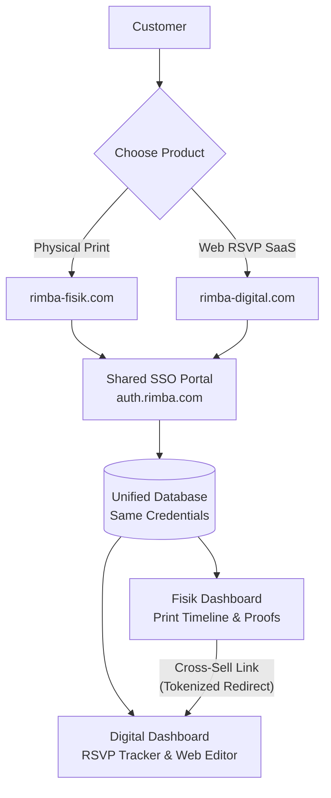
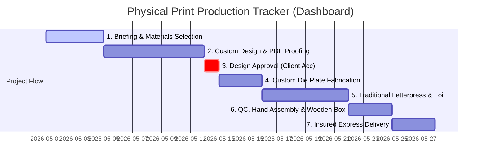

# Architecture & Integration: Rimba Fisik & Rimba Digital

This document details the navigation flow, authentication integration, and dashboard architecture for **Rimba Fisik** (physical invitation cards) and its relationship with its upcoming sibling service **Rimba Digital** (SaaS web invitations & guest management).

---

## 1. Ecosystem Overview

Due to corporate stock ownership, legal structures, and distinct operational workflows (artisan print fabrication vs. cloud-based SaaS), `rimba-fisik` and `rimba-digital` are hosted on separate domains. However, they share a unified customer account database, providing a seamless Single Sign-On (SSO) experience.

---

## 2. Navbar Flow & Integration (Rimba Fisik)

The navbar inside `Header.tsx` and `PageHeader.tsx` must balance two constraints:
1. Promote and sell premium physical cards (our core high-margin offering).
2. Cross-promote and integrate with the digital sibling brand without causing confusion or losing customers.

### Proposed Navbar Structure
Instead of generic placeholder keys (like "ecosystem" or "governance"), the `rimba-fisik` navbar should reflect physical print vocabulary:

| Navbar Item | Target Route | Purpose / Action |
| :--- | :--- | :--- |
| **Collections** | `/products` | Showcases the **3-Tier kasta** (Leaf, Timber, Heartwood) physical invites. |
| **The Craft** | `/craft` or `/about` | Explains artisanal techniques (debossing, letterpress, gold hot foil stamping). |
| **Cara Pesan** | `#order-process` or `/workflow` | Explains the physical print fabrication steps from DP to shipping. |
| **Rimba Digital ↗** | `https://rimba-digital.com` | Premium external bridge showcasing our modern digital invitation suite. |
| **Login** | `/login` | Redirects to the SSO page. |

---

## 3. What the Fisik Dashboard Contains

When a client buys physical cards, they do not need a web editor or a real-time digital RSVP list (unless they also buy the digital package). Instead, they need a platform to manage a **bespoke, multi-stage print manufacturing project**.

The physical client dashboard contains:

### Key Modules:

#### 1. Interactive Print Tracker (Progress Timeline)
- Shows the real-time stage of the invitation crafting process.
- Visual micro-updates: "Now carving your custom brass die plate for gold embossing", "Cards are currently on the letterpress machine".
- Reduces customer support inquiries via WhatsApp by 70%.

#### 2. Digital Proofing & Legal Approval Panel (ACC Cetak)
- High-fidelity PDF display of the final print layouts.
- Line-by-line verification checklist for the couple:
  - [ ] Parents' names spelling verified.
  - [ ] Date, venue, and time verified.
  - [ ] Map QR code address verified.
- **The "ACC CETAK / APPROVE FOR PRINT" button**: Once pressed, the file is sent to production, lock-closing further edits and establishing legal consent for print correctness.

#### 3. Envelope Address & Calligraphy Manager
- A structured table allowing the couple to type or upload (via CSV/Excel) their guest names and home addresses.
- Simplifies physical label printing or envelope calligraphy, removing Excel file exchange overhead.

#### 4. Financial Milestones Portal
- Visual breakdown of the **50% Down Payment (DP)** and **50% Final Settlement**.
- Direct upload portal for bank transfer payment receipts.
- Automatic PDF invoice generation for their records.

---

## 4. The Sibling Bridge Integration

The magic of having the same account database for both sites is the **cross-selling flow**:

1. **The Promo Banner (Inside Fisik Dashboard)**: 
   *"Want a digital RSVP page to match your gorgeous Heartwood paper invitations? Claim your 30% off Rimba Digital bundle."*
2. **SSO Transition**: 
   Clicking the button redirects them to `rimba-digital.com/onboarding?token=XYZ`.
3. **Data Auto-Population**:
   Rimba Digital reads the token, registers the account, and automatically grabs the **couple's names, event date, venue coordinates, and theme styles** from the physical order database.
4. **Instant Matching Design**:
   The couple gets a pre-configured digital template matching their physical card's typography and color scheme in seconds!
